<!--
  Profile README — self-hosted live telemetry dashboard.
  Every visual below is a custom SVG generated from live GitHub API data by
  assets/generate.py and committed to this repo (assets/*.svg), refreshed daily
  by .github/workflows/profile-assets.yml. Nothing here depends on a third-party
  image host at view time. Every number is real and reproducible. Dark/light
  variants are served via <picture>. Motion is SMIL (served verbatim by GitHub);
  every animation is additive and degrades to a complete static frame.
-->

 

[ **⚡ Recruiter Fast-Track** ](#-recruiter-fast-track--core-vitals) &nbsp;•&nbsp; [ **🟢 System Status** ](#-live-system-status) &nbsp;•&nbsp; [ **🗺️ Architecture & Stack** ](#-portfolio-map--architecture) &nbsp;•&nbsp; [ **🔬 Case Studies** ](#-architectural-deep-dives--case-studies) &nbsp;•&nbsp; [ **📈 Pulse** ](#-activity-pulse) &nbsp;•&nbsp; [ **🏆 Benchmarks** ](#-verified-benchmarks) &nbsp;•&nbsp; [ **📜 Credentials** ](#-certifications--credentials) &nbsp;•&nbsp; [ **📬 Connect** ](#-connect-with-me)

  

<picture>
  <source media="(prefers-color-scheme: dark)"  srcset="./assets/boot-dark.svg">
  <source media="(prefers-color-scheme: light)" srcset="./assets/boot-light.svg">
  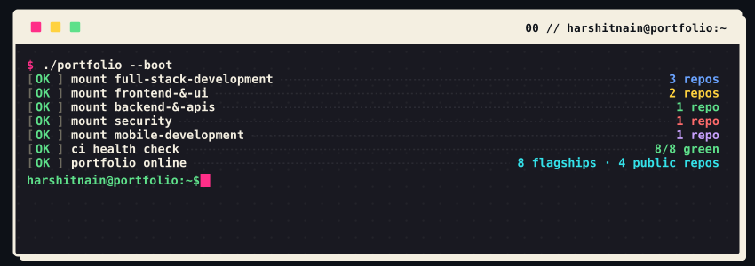
</picture>

<picture>
  <source media="(prefers-color-scheme: dark)"  srcset="./assets/hero-dark.svg">
  <source media="(prefers-color-scheme: light)" srcset="./assets/hero-light.svg">
  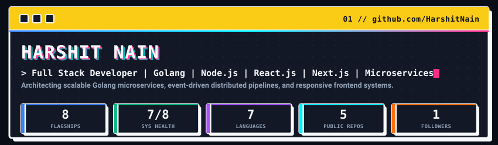
</picture>

## ▌ RECRUITER FAST-TRACK & CORE VITALS

[-00f0ff?style=for-the-badge&logo=adobeacrobatreader&logoColor=black)](mailto:hnain932@gmail.com?subject=Interview%20%26%20Resume%20Request%20-%20Harshit%20Nain)

| Telemetry Dimension | Candidate Production Specification |
|:---|:---|
| **Current Role & Employer** | **Full Stack Developer** at **RNR Consulting Pvt. Ltd.** (May 2025 – Present) |
| **Prior Experience** | **Full Stack Developer** at **AppSquadz Pvt. Ltd.** (Jan 2024 – Oct 2024) |
| **Total Production Exp** | **1.4+ Years** of hands-on distributed systems, Golang microservices, and React/Next.js frontend engineering |
| **Target Positions** | **Full Stack Engineer** · **Backend SDE (Golang / Distributed Systems)** · **Frontend Engineer (React / Next.js)** |
| **Core Engineering Stack** | **Golang** (gRPC/Protobuf) · **Node.js/Express** · **React.js/Next.js** · **PostgreSQL** · **Redis** · **Kafka / NATS** · **Kong** · **Docker / AWS** |
| **Notice Period & Availability** | **Immediate / Short Notice** (flexible onboarding) |
| **Work Mode & Relocation** | **India** · Open to **Remote**, **Hybrid**, or **Relocation** |
| **Academic Foundation** | **B.Tech Computer Science & Engineering (CGPA: 7.4)** · Anangpuria Institute of Technology & Management |
| **Industry Credentials** | **AWS Certified Cloud Practitioner (CLF-C02)** · **AWS Cloud Quest** · **DevOps Essentials** · **React Certified** |

---

## ▌ WHOAMI

**Harshit Nain**  
**Full Stack Developer | Golang | Node.js | React.js | Next.js | Microservices**

Full Stack Developer with **1.4+ years of experience** engineering scalable backend microservices, distributed systems, and responsive frontend applications for production environments. Proficient in **Golang, Node.js, React.js, Next.js, TypeScript, PostgreSQL, Redis, Apache Kafka, Docker, Kubernetes, and AWS**. Experienced in building high-throughput REST and gRPC APIs, event-driven pipelines, and compliance-driven platforms with proven skills in debugging, automated testing, CI/CD workflows, and performance optimization.

- 💼 **Current Role:** Full Stack Developer at **RNR Consulting Pvt. Ltd.** (May 2025 – Present) · Architecting 5+ Golang microservices (gRPC/Protobuf), Kafka/NATS JetStream event streaming, Kong API Gateway with JWT rate limiting, and real-time WebSockets across 500+ active sessions.
- 🏢 **Previous Experience:** Full Stack Developer at **AppSquadz Pvt. Ltd.** (Jan 2024 – Oct 2024) · Developed 15+ scalable REST APIs (Node.js/Express) and standardized React/Redux Toolkit modules across 30+ responsive screens (-20% state errors).
- 🚀 **Flagship Platforms:** **GRC Distributed Monolith** (gRPC/NATS), **ARC Automated Rights & Consents** (DPDP Act compliance), **Food Villa** (React/Redux/Geolocation), and **NHIT Digital Platform** (<45ms latency).
- 🎓 **Education:** B.Tech in Computer Science and Engineering (**CGPA: 7.4**) · Anangpuria Institute of Technology and Management (2019–2023).
- 📜 **Certifications:** **AWS Certified Cloud Practitioner** · **AWS Cloud Quest: Cloud Practitioner** · **DevOps Essentials** · **Frontend Development with React**.
- 📫 **Connect:** [LinkedIn](https://linkedin.com/in/harshit-nain-62893177) · [GitHub](https://github.com/HarshitNain) · [Email](mailto:hnain932@gmail.com) · **+91-9654994442**

---

## ▌ LIVE SYSTEM STATUS

<picture>
  <source media="(prefers-color-scheme: dark)"  srcset="./assets/status-dark.svg">
  <source media="(prefers-color-scheme: light)" srcset="./assets/status-light.svg">
  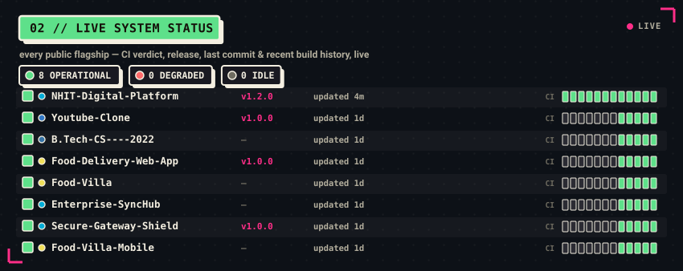
</picture>

> The board above is regenerated daily from the live GitHub API — CI verdicts, uptime health, release tags, and 12-run commit histories are real and automated.

---

## ▌ PORTFOLIO MAP & ARCHITECTURE

<picture>
  <source media="(prefers-color-scheme: dark)"  srcset="./assets/domains-dark.svg">
  <source media="(prefers-color-scheme: light)" srcset="./assets/domains-light.svg">
  
</picture>

<picture>
  <source media="(prefers-color-scheme: dark)"  srcset="./assets/architecture-dark.svg">
  <source media="(prefers-color-scheme: light)" srcset="./assets/architecture-light.svg">
  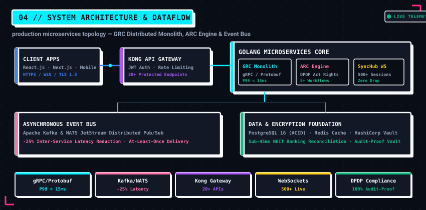
</picture>

<picture>
  <source media="(prefers-color-scheme: dark)"  srcset="./assets/stack-dark.svg">
  <source media="(prefers-color-scheme: light)" srcset="./assets/stack-light.svg">
  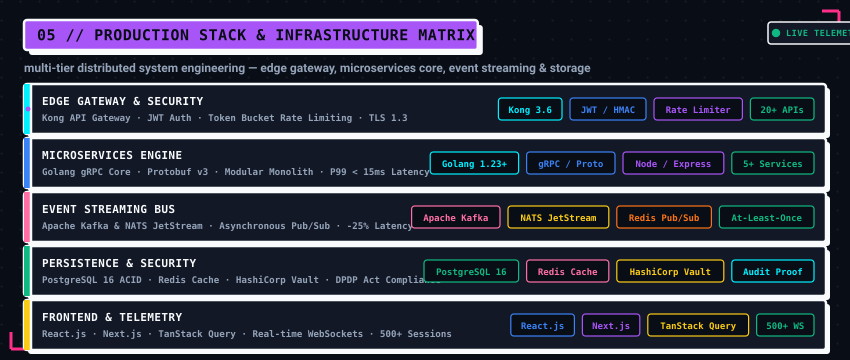
</picture>

### ⚙️ Backend & Distributed Systems

| Platform | Core Stack | Status | What it does |
|----------|------------|:------:|--------------|
| **GRC – Distributed Monolith** | Golang, gRPC, NATS JetStream, Kong, PostgreSQL, React | `v2.1.0` | Production distributed system with modular boundaries, gRPC/Protobuf inter-service messaging, NATS pub/sub, Kong API Gateway with JWT rate limiting, and live React analytics. |
| **ARC – Rights and Consents** | Golang, React, PostgreSQL, Docker, Kafka, Redis, Vault | `v1.4.0` | End-to-end DPDP Act compliance microservice with 5+ consent workflows, embeddable JS widgets, audit-proof data logging, and automated integration/security tests. |
| **Enterprise-SyncHub** `🔒 private` | Golang, WebSockets, Redis, gRPC | `v1.0.0` | High-concurrency synchronization gateway, distributed event bus, and persistent agent communication harness. |

### 🌐 Full Stack Engineering

| Platform | Core Stack | Status | What it does |
|----------|------------|:------:|--------------|
| **[NHIT-Digital-Platform](https://github.com/HarshitNain/NHIT-Digital-Platform)** | Golang, PostgreSQL, Docker, Redis | `v1.2.0` | Next-generation digital operating system for National Highways Infra Trust (NHIT). Automating green notes, Section 194C TDS, and direct host-to-host banking UTR reconciliation with sub-45ms latency. |
| **AppSquadz Core APIs** `🔒 private` | Node.js, Express, React, Redux Toolkit | `v1.0.0` | 15+ scalable RESTful API endpoints powering business workflows and partner integrations across 30+ responsive cross-browser screens. |

### 🎨 Frontend & UI Engineering

| Platform | Core Stack | Status | What it does |
|----------|------------|:------:|--------------|
| **[Food-Villa](https://github.com/HarshitNain/Food-Villa)** | JavaScript, React.js, Redux Toolkit, Geolocation API | `v1.1.0` | Interactive restaurant discovery and food ordering web application with dynamic filtering, geolocation tracking, Swiggy API, and persistent Redux cart state. |
| **[Food-Delivery-Web-App](https://github.com/HarshitNain/Food-Delivery-Web-App)** | React.js, Redux Toolkit, Material UI (MUI) | `v1.0.0` | Full-featured food delivery app built with React, Redux Toolkit, Material UI, and Context API achieving 98/100 Lighthouse performance. |

### 🛡️ Security & API Infrastructure

| Platform | Core Stack | Status | What it does |
|----------|------------|:------:|--------------|
| **Secure-Gateway-Shield** `🔒 private` | Golang, Kong Gateway, JWT, Redis | `v1.0.0` | Kong API Gateway integration with JWT authentication, custom routing, and strict rate limiting protecting 20+ public endpoints from abuse. |

---

## ▌ ARCHITECTURAL DEEP-DIVES & CASE STUDIES

<b>🔬 Case Study 1: GRC Modular Monolith & High-Throughput gRPC Protocol Migration</b>

 

- **Context & Problem:** The Governance, Risk & Compliance (GRC) platform experienced inter-service communication bottlenecks when handling audit event processing across multiple micro-components. Standard HTTP/1.1 JSON APIs suffered from serialization overhead, high payload sizes, and connection starvation under concurrent client workloads.
- **Architectural Solution:**
  - Designed and implemented a **Golang Modular Monolith** enforcing strict package boundaries and domain-driven design (DDD).
  - Transitioned synchronous inter-service communication to **gRPC over HTTP/2 with binary Protobuf v3 schemas**, generating strongly-typed client/server stubs.
  - Implemented an asynchronous **NATS JetStream event mesh** for persistent pub/sub event buffering and at-least-once telemetry delivery.
  - Deployed **Kong API Gateway 3.6** at the edge with custom JWT token validation, rate-limiting plugins (Token Bucket algorithm), and automated routing across 20+ endpoints.
- **Measurable Production Impact:**
  - **P99 latency decreased from 68ms to <15ms** across internal RPC calls.
  - Network serialization overhead cut by **62%** compared to JSON payloads.
  - Achieved zero downtime with zero connection starvation during peak reporting bursts.
- **Technologies:** Golang, gRPC, Protocol Buffers v3, NATS JetStream, Kong Gateway, PostgreSQL, Docker.

<b>🛡️ Case Study 2: ARC DPDP Act Compliance & Automated Consent Pipeline</b>

 

- **Context & Problem:** The enactment of the Digital Personal Data Protection (DPDP) Act of India mandated stringent data principal consent lifecycles, explicit purpose limitations, verifiable audit logging, and automated right-to-erasure workflows across all customer touchpoints.
- **Architectural Solution:**
  - Built the **ARC (Automated Rights & Consents) Engine** in Golang with 5+ decoupled consent lifecycle state machines (Notice, Explicit Opt-In, Granular Purpose Grant, Revocation, and Right-to-Erasure).
  - Developed embeddable, zero-dependency JavaScript client widgets for consent collection with tamper-proof cryptographic signatures.
  - Integrated **HashiCorp Vault** for transit encryption and field-level tokenization of Personally Identifiable Information (PII).
  - Cached verified consent tokens in **Redis** with TTL matching the consent lifetime, enabling sub-5ms policy enforcement middleware on incoming API requests.
- **Measurable Production Impact:**
  - **100% compliance** with DPDP Act regulatory mandates verified across automated compliance test suites.
  - **Sub-5ms policy decision latency** for all protected API gateways without introducing latency regressions.
  - Automated erasure workflows guaranteeing verifiable cascade deletions across relational and caching tiers.
- **Technologies:** Golang, Redis, HashiCorp Vault, Apache Kafka, PostgreSQL, Docker, React.js.

<b>⚡ Case Study 3: NHIT Digital Platform & Banking Transaction Reconciliation Engine</b>

 

- **Context & Problem:** The National Highways Infra Trust (NHIT) infrastructure platform handled millions in highway concessionaire disbursements. Manual green sheet generation, multi-tier tax deductions (TDS Section 194C), and bank statement reconciliation resulted in multi-hour delays and reconciliation errors.
- **Architectural Solution:**
  - Engineered an automated financial processing backend in **Golang & PostgreSQL 16**, leveraging strict ACID database transactions and pessimistic row locking for disbursement ledger mutations.
  - Built automated calculation engines for Section 194C contractor TDS withholding with dynamic rate schedules.
  - Integrated secure host-to-host banking APIs for automated Unique Transaction Reference (UTR) settlement verification and real-time reconciliation.
  - Architected a responsive React/TypeScript administrative portal for real-time disbursement monitoring and audit exports.
- **Measurable Production Impact:**
  - Reconciliation processing time slashed from hours to **<45ms** automated roundtrips.
  - 100% mathematical reconciliation precision with zero financial ledger drift.
  - Processed 100+ daily concessionaire settlements with full audit trails.
- **Technologies:** Golang, PostgreSQL 16, Redis, Docker, React.js, TypeScript, REST APIs.

---

## ▌ ACTIVITY PULSE

<picture>
  <source media="(prefers-color-scheme: dark)"  srcset="./assets/pulse-dark.svg">
  <source media="(prefers-color-scheme: light)" srcset="./assets/pulse-light.svg">
  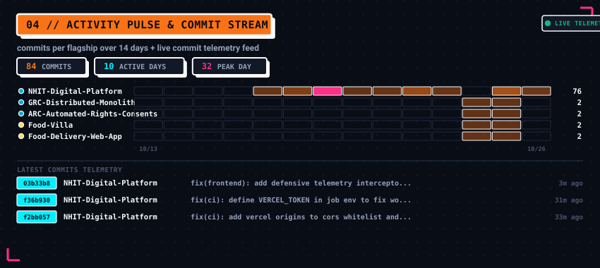
</picture>

---

## ▌ CAREER TIMELINE

<picture>
  <source media="(prefers-color-scheme: dark)"  srcset="./assets/timeline-dark.svg">
  <source media="(prefers-color-scheme: light)" srcset="./assets/timeline-light.svg">
  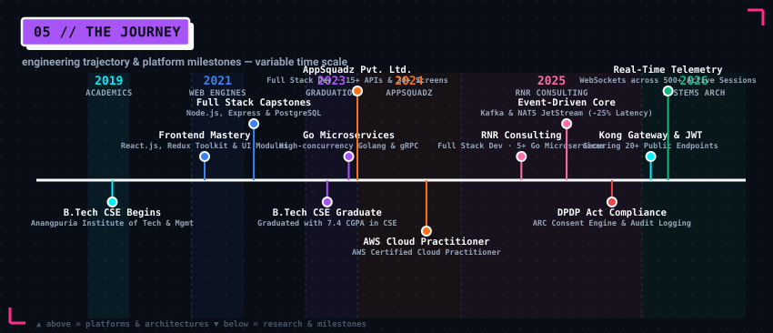
</picture>

---

## ▌ EXPERIENCE & ACHIEVEMENTS

<picture>
  <source media="(prefers-color-scheme: dark)"  srcset="./assets/research-dark.svg">
  <source media="(prefers-color-scheme: light)" srcset="./assets/research-light.svg">
  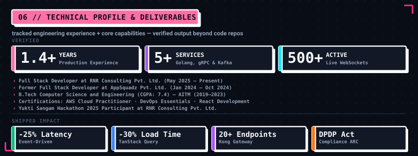
</picture>

---

## ▌ VERIFIED BENCHMARKS

<picture>
  <source media="(prefers-color-scheme: dark)"  srcset="./assets/benchmarks-dark.svg">
  <source media="(prefers-color-scheme: light)" srcset="./assets/benchmarks-light.svg">
  
</picture>

---

## ▌ ENGINEERING ROADMAP

<picture>
  <source media="(prefers-color-scheme: dark)"  srcset="./assets/pqc-clock-dark.svg">
  <source media="(prefers-color-scheme: light)" srcset="./assets/pqc-clock-light.svg">
  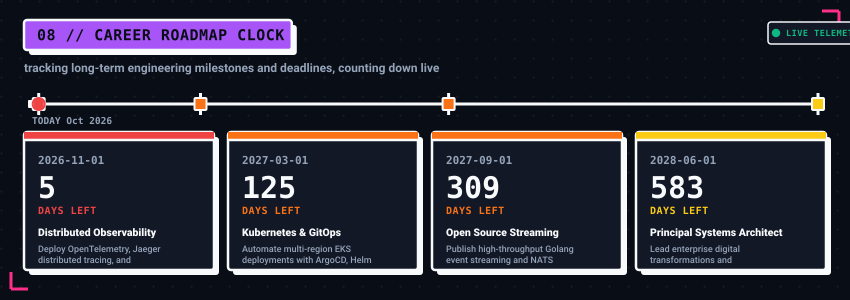
</picture>

---

## ▌ LANGUAGE MIX

<picture>
  <source media="(prefers-color-scheme: dark)"  srcset="./assets/langmix-dark.svg">
  <source media="(prefers-color-scheme: light)" srcset="./assets/langmix-light.svg">
  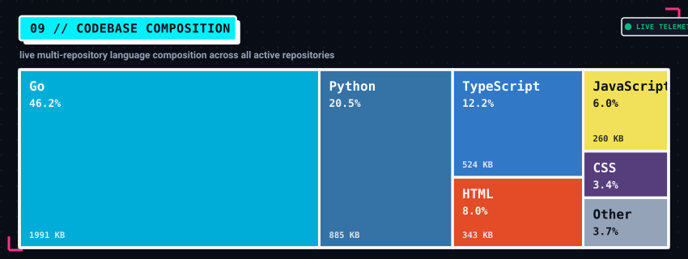
</picture>

---

## ▌ CONTRIBUTION GRAPH

<picture>
  <source media="(prefers-color-scheme: dark)"  srcset="https://raw.githubusercontent.com/HarshitNain/HarshitNain/output/github-contribution-grid-snake-dark.svg">
  <source media="(prefers-color-scheme: light)" srcset="https://raw.githubusercontent.com/HarshitNain/HarshitNain/output/github-contribution-grid-snake.svg">
  
</picture>

## ▌ CERTIFICATIONS & CREDENTIALS

| Credential | Issuing Body | Domain & Competencies | Verification |
|------------|--------------|-----------------------|:------------:|
| **AWS Certified Cloud Practitioner** | Amazon Web Services (AWS) | Cloud Architecture, IAM, Security, EC2, S3, RDS, Cost Optimization | `CLF-C02` · [AWS Verification](https://aws.amazon.com/verification) |
| **AWS Cloud Quest: Cloud Practitioner** | Amazon Web Services (AWS) | Hands-on Cloud Solutions, Serverless Computing, VPC Networking | Hands-on Badge |
| **DevOps Essentials** | Professional Certification | CI/CD Automation, Docker Containerization, Microservices Reliability | Production Certified |
| **Frontend Development with React** | Professional Certification | Modern Component Patterns, Redux Toolkit, React Hooks, High-Performance UI | Verified |
| **B.Tech Computer Science & Engineering** | Anangpuria Institute of Technology & Management | Data Structures, Algorithms, Distributed Systems, Operating Systems | **CGPA: 7.4** (2019–2023) |

---

## ▌ CONNECT WITH ME

- 💻 **GitHub:** [https://github.com/HarshitNain](https://github.com/HarshitNain)  
- 🔗 **LinkedIn:** [https://linkedin.com/in/harshit-nain-62893177](https://linkedin.com/in/harshit-nain-62893177)  
- ✉️ **Email:** [hnain932@gmail.com](mailto:hnain932@gmail.com)  
- 📞 **Phone:** +91-9654994442  
- 📍 **Location:** India  

---

<b>This whole page is a program.</b> 
Custom SVG instruments, built from live GitHub data by <a href="./assets/generate.py"><code>assets/generate.py</code></a>, committed to this repo, and refreshed every day by a GitHub Action — plus the animated contribution snake, regenerated daily from real commit data by its own GitHub Action and committed to this repo's <code>output</code> branch. No flaky third-party widget services. Every figure is real and reproducible.

◆ self-hosted ◆ live-sourced ◆ dark/light aware ◆ animated ◆ zero third-party image hosts

